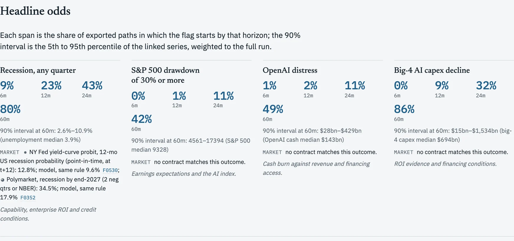
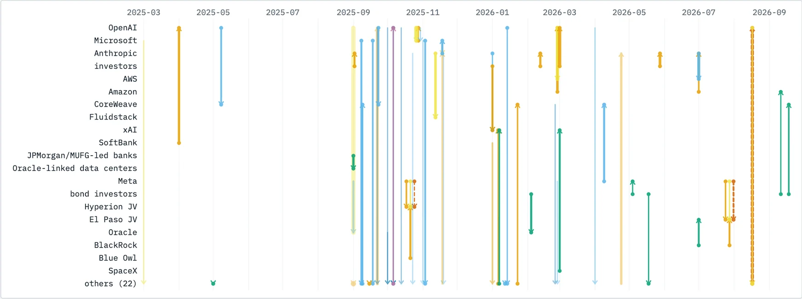
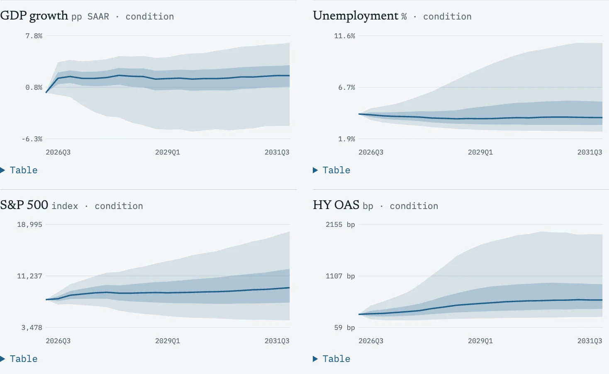

<!-- owner:scene Why did you build this simulation? The post opens with what it is, not why. One true line ("I wanted to see X") would carry the opening. -->

I built a stock-flow-consistent simulation of the US economy with an AI investment boom in it. I ran 50,000 paths from 2026Q3 to 2031Q3 and exported 10,000 of them. The full report is at [/research/ai-economy/](/research/ai-economy/), using data as of 2026-10-17.

I haven't backtested the model or checked it against out-of-sample history yet, so treat these as model runs rather than a forecast. The caveats are at the bottom.

## What came out of the runs

The headline numbers below are the share of the 10,000 exported paths where each event starts by that horizon.

In these runs, a recession within five years happens more often than not. Recession odds in any quarter are 9% at 6 months, 23% at 12 months, 43% at 24 months and 80% at 60 months. Over 20 quarters the model's long run sits around 80%, compared to 74.9% in US history from 1953 to 2026 under the same rule (two negative quarters or a jump in unemployment), so the model runs a few points higher than history.

<!-- owner:question Did any result surprise you? For example the AI boom being a smaller lever than the yield curve, or the model sitting below Polymarket. One honest reaction, only if you had one. -->

The AI boom wasn't the biggest driver of recession odds. A flatter yield curve adds about 8 points to the odds of entering a recession, while the AI boom adds 4.3 points in the report's chart and about 5 in its text.

<!-- owner:confirm Is "watched the 24-month odds move from their 43% baseline" a fair description of how you ran the sensitivity sweep? -->

To see what moved the numbers most, I set each parameter to its low and high bound one at a time and watched the 24-month recession odds move from their 43% baseline. The top three drivers were baseline recession risk (29% to 69%), how strongly credit spreads raise recession risk (29% to 68%) and recession-risk calibration (35% to 54%). None of those three is an AI parameter, which means the output depends more on my baseline assumptions than on the boom itself.

Compared with prediction markets and published models, my runs come out lower. For a recession by the end of 2027, the model gives 17.9% against Polymarket's 34.5%. Against the NY Fed's 12-month probit it gives 9.6% against the NY Fed's 12.8%. For each comparison I used the model rule that matches the market's contract, and the model came in 3 to 17 points below every venue with a matching rule. I don't know yet if I'm missing something or if the markets are pricing in something I left out.

On the AI side, big-4 AI capex declines in 32% of paths by 24 months and 86% by 60 months. OpenAI hits distress in 11% of paths at 24 months and 49% at 60, while Anthropic is at 2% and 17%. An S&P 500 drawdown of 30% or more shows up in 11% of paths at 24 months and 42% at 60.

The spending is also much larger than the revenue. The report counts \$1,113.6B committed through binding deals, excluding \$118B of contingent guarantees and leaving out another \$975B that has only been announced. Big-4 2026 capex guidance is \$760bn against \$152bn of disclosed direct AI revenue. I also found 5 committed round-trip loops with \$55B circulating on committed legs. I'm flagging that as round-trip exposure rather than accusing anyone of anything. Here are the deals I have found so far, with one lane per company:

For the bubble indicators, levels look stretched while momentum is still calm. Four of the five sit above their 90th historical percentile, CAPE is 40.6x and credit spreads are tight. The gauge reads Alert at 98.4 for October 2026, which the report links to its full-bust cluster. Even so, the stress shows up in three AI-exposed names, CoreWeave, SoftBank and Oracle, rather than across the wider market.

The 10,000 exported paths split into four clusters. The largest, "The build that still breaks" (49% of paths), has AI succeeding while the buildout is financed so aggressively that a recession is still the most common outcome. In "The credit stretch" (29%), credit tightens and the labs go public while the broader economy holds up. "The AI disappointment" (15%) is where the payoff falls short, capex cools, both labs hit distress and a rescue is likely. The smallest cluster, "The full bust" (7%), has creative work displaced, the AI index cutting in half and the credit complex unwinding together.

Here are the fan charts across the exported paths:

A big chunk of the spend leaves the US too. Out of \$970bn in AI capex, 42% leaks abroad in the model, with Taiwan the most exposed.

## What I don't trust yet

- There is no backtest. The stationary-moment gate is the closest check I have right now.
- At 60 months, 23.5% of paths push unemployment below its 1971-2019 low. I reported it in the write-up, and I haven't fixed it yet.
- Some bubble indicators are plotted but left out of the score, and the AI index bubble test is unvalidated.
- A lot of the parameters come from my own judgment instead of data, and method changes moved the results around. Between an earlier draft and the regenerated run, 12-month recession odds moved from 29% to 19%.

You can [open the report](/research/ai-economy/) and change the conditions yourself. Let me know if you spot anything off.
