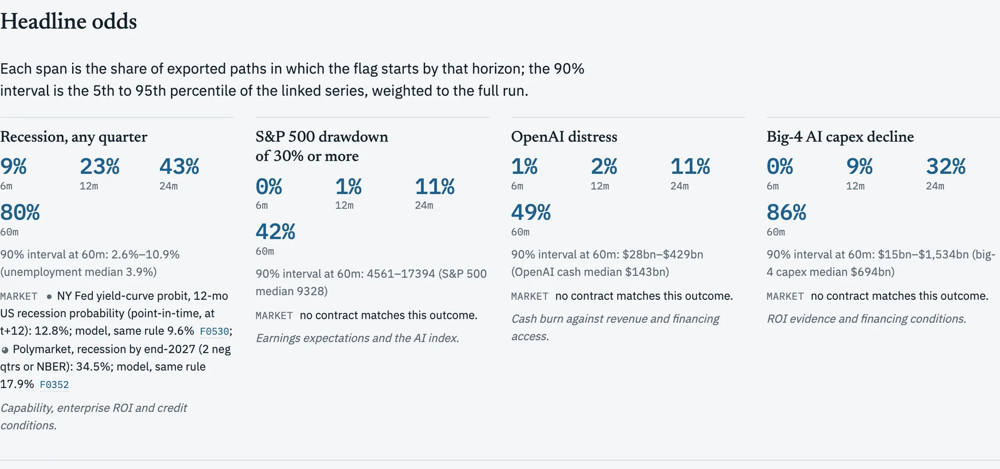
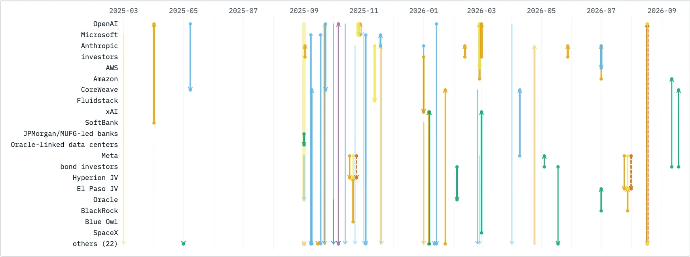
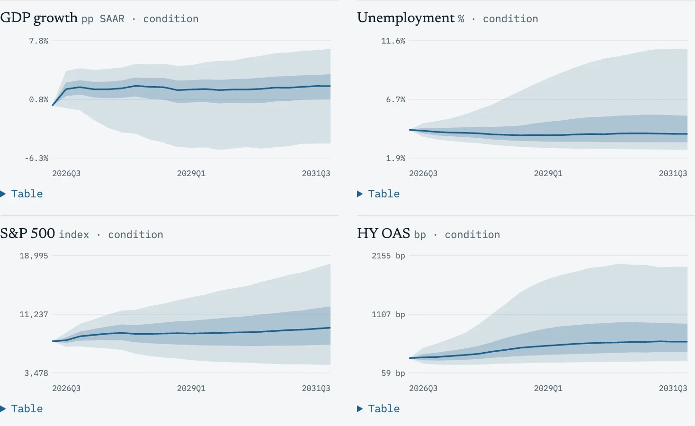

I have been building a simulation of the US economy with the AI boom in it. I call it EcoSimulation. It runs 50,000 paths, I export 10,000 of them, and the whole thing is a report you can play with at [/research/ai-economy/](/research/ai-economy/). Here are the things that stood out to me.

First, the important part. **This is not a forecast.** There is no backtest yet, the model has not been validated against out-of-sample history, and the report lists the problems I know about. They are at the end of this post.

## What I saw

Headline odds first, straight from the report:

**1. Recession over 5 years is the base case, and that is mostly just how 5 years work.**
Recession odds (any quarter) are 9% at 6 months, 23% at 12 months, 43% at 24 months and 80% at 60 months. Sounds scary, but over 20 quarters the model's long run is 80.2% and history (1953-2026) is 74.9%. Five years is a long time.

**2. The AI boom is not the biggest lever.**
For entering a recession, a flatter yield curve adds about 8 points. The AI backdrop adds about 4. And what moves the 24 month odds most (baseline 43%) is not AI at all, it is the baseline recession risk (29% to 69%) and how strongly credit spreads raise it (29% to 68%). The answer depends more on my assumptions than on the boom.

**3. My model is more relaxed than the markets.**
Model 17.9% vs Polymarket 34.5% for a recession by end of 2027. Model 9.6% vs NY Fed 12.8%. It is below every venue with a matching rule, by 3 to 17 points. Either I am missing something or they are pricing something I am not. Not sure yet which.

**4. What actually breaks is the AI side.**
Big-4 AI capex declines in 32% of paths by 24 months and 86% by 60 months. OpenAI distress is 11% at 24 months and 49% at 60. Anthropic is 2% and 17%. An S&P 500 drawdown of 30% or more is 11% at 24 months and 42% at 60.

**5. The money is a lot more than the revenue.**
\$1,113.6B is committed through binding deals. 2026 capex guidance for the big 4 is \$760bn against \$152bn of disclosed direct AI revenue. There are 5 committed round-trip loops with \$55B circulating on committed legs. That is round-trip exposure, not an accusation of anything. Every deal and who paid whom, one lane per company:

**6. Bubble indicators say stretched, not panicking.**
4 of 5 are beyond their 90th historical percentile. CAPE is 40.6x. But credit spreads are tight and the stress is in 3 AI-exposed names (CoreWeave, SoftBank, Oracle), not market-wide. Level stretched, momentum calm.

**7. Four ways it plays out.**
The 10,000 paths cluster into four stories: the build that still breaks (49%), the credit stretch (29%), the AI disappointment (15%) and the full bust (7%). Even when AI works, if it is financed aggressively a recession is the most common outcome. And this is the spread behind those stories, GDP, unemployment, the S&P 500 and high-yield spreads across the 10,000 paths:

**8. The US is not the only one that feels it.**
Of \$970bn of AI capex, 42% leaks out of the US, and Taiwan is the most exposed.

## What I don't trust yet

- No backtest. The stationary-moment gate is the closest check I have.
- At 60 months, 23.5% of paths run unemployment below the 1971-2019 low. Reported, not fixed.
- Some bubble indicators are NaN or shown but not counted, and the AI index bubble test is unvalidated.
- A lot of parameters are my judgment, not data. Changing methods moved the numbers, for example the 12 month recession odds went from 29% to 19% between a draft and the regenerated run.

If you want to poke at it, [open the report](/research/ai-economy/) and change the conditions yourself. If you find something wrong, tell me.
