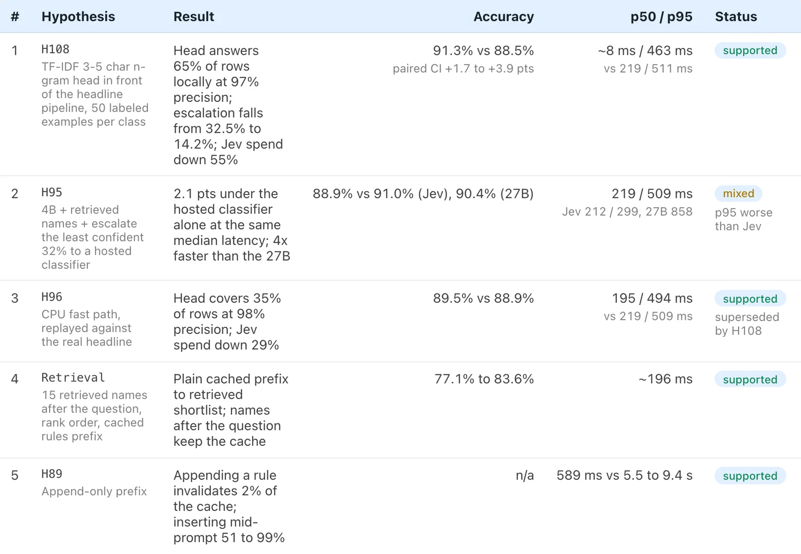
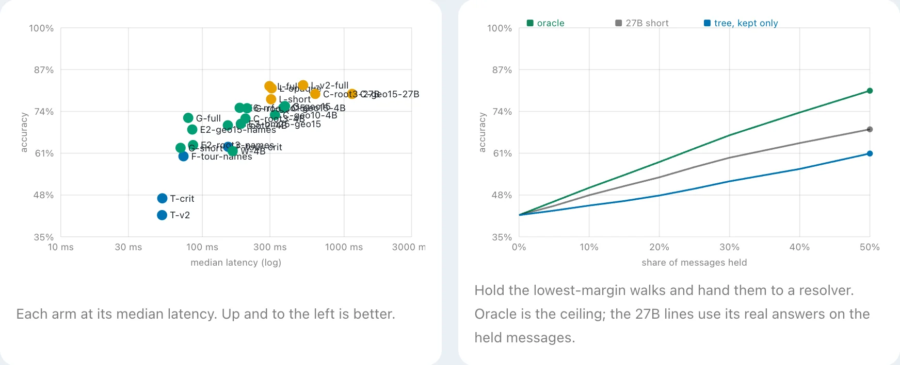
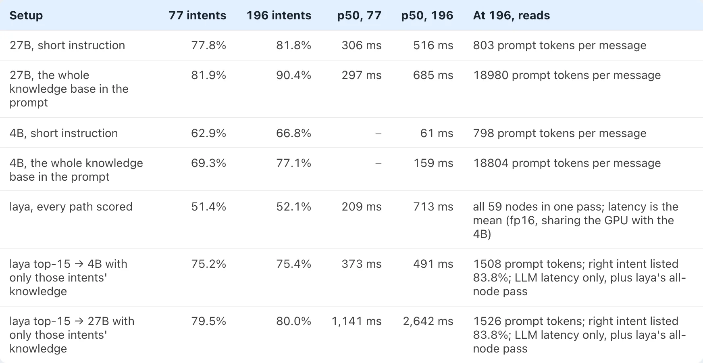

<!-- owner:scene Why did you start building Brev, or what made you want a small local router in the first place? The post gives only the research question. -->

I have been building Brev. Its small model is laya, a 400M encoder that walks a decision tree and reads only the criteria on the path it takes. I wanted to know if the tree could hold the knowledge, so laya could match a 27B model given a short instruction, without the 27B's latency.

On its own, it couldn't. The tree lost by a lot. What worked was a chain of cheaper steps in front of the big model.

I tested on Banking77 (77 intents), then on 196 intents, then on a 478-intent set, and kept a ledger of every hypothesis, the failed ones too. The full report is [here](/research/brev-tree-benchmark/).

<!-- owner:voice The seven numbered claims became section headings. Keep the headings, or bring the numbered list back? -->

## The chain I ended with

It has three stages. A TF-IDF head answers the rows it is sure about: 225 of 300 in the live run, and 96.9% of those are right. Qwen3-4B (Q4_K_M) takes the rest with 8 retrieved examples. The 27B only sees the rows the 4B is least sure about, 27 of 300, which is 9%. There it gets a short prompt, the top 30 candidates and 16 examples.

Measured live, end to end, the chain got 93.3% on the 300 rows. The 27B scored 93.9% on all 4,938 rows of that set. Per query the chain averaged 49 ms, and one 27B call took about 10 s. At 300 rows the intervals are wide, so I can't tell the two accuracies apart. Close, not equal.

## The tree walk is fast, but not good

laya's greedy walk takes 52 ms at p50 and gets 47.0% on Banking77. The 27B with a short instruction gets 77.8% at 306 ms. That is 30.8 points behind (95% CI -32.8 to -28.9).

<!-- owner:question Was anything here a surprise to you, for example the shuffled-criteria 8.9%, or the TF-IDF head beating the pipeline? One honest reaction would help the voice. -->

The criteria carry the knowledge. Names only get 36.8%, opaque ids plus criteria 40.6%, and both 47.0%. Shuffle the criteria between siblings and it falls to 8.9%. laya follows the text, even when the text is wrong.

## At 196 intents, flat rules in the prompt beat the tree

The 27B with every rule in the prompt got 90.4% at 685 ms p50. The best 27B cascade over the tree got 81.6% at 4,118 ms p50. Walking the tree node by node had about 40% recall, against 98% for flat retrieval (RRF). The report's summary puts that at 196 to 605 intents. The ledger's H46 concludes that the tree's value has to come from fewer prompt tokens, not from routing accuracy.

## A small model is fast alone, and slower under load

The 4B with every rule in the prompt, about 18.8k tokens, gets 77.1% at 159 ms median in the 196-intent run. That run was served from llama.cpp's prefix cache: 99.9% of prompt tokens were cached, one request at a time. I didn't measure it without the cache. Two timing runs on the same cache, with no accuracy numbers, take 447 ms with 4 requests in flight and 938 ms with 8. The cache hit rate stayed at 99.6 to 99.9%, so the slowdown is queueing, not cache loss.

Rule order matters for that cache. Appending a rule invalidated 2% of it (first request 589 ms). Alphabetical order invalidated about 51% (5.5 s), and inserting at the front 99.8% (9.4 s). Accuracy did not change.

## The boring part carries it

A TF-IDF character n-gram head in front of the pipeline answers about 65% of rows locally at 97% precision. It cuts hosted-classifier spend by 56% at k=50, from \$0.29 to \$0.13 per 1k. And accuracy goes up too: 91.3% against 88.5% for my headline pipeline (paired CI +1.7 to +3.9 points). Its p50 is about 8 ms, against 219 ms. The report's short answer: the headline pipeline holds up, and a cheap trained head in front improves both accuracy and cost.

The retrieved examples are what make the 4B useful. On 4,948 rows and 478 intents, the head alone scored 89.6%. The 4B with only candidate names scored 78.6%, worse than the head. With the 8 nearest labelled examples it scored 94.0%, but those had gold labels. With simulated 27B-style label noise the same stage scored 91.6%.

Learning new intents from a few examples is the weak part.

## What I don't trust yet

- The chain ran on 300 rows, with 27 escalated, on one dataset and one seed. The Mac was loaded, and the 4B call includes about 10 to 15 ms of network.
- The 27B baseline used a different prompt: all 200 classes, constrained to the top 200. The escalation stage uses a shorter one.
- The example labels in the 4B stage are simulated 27B-style noise, not live 27B output.
- Banking77 is public, so the models may have seen it. The control with opaque ids scored 81.2% vs 81.9% with real names, so the names do not explain the 27B's lead. The 478-intent set includes CLINC150 labels, which are public too.
- The 27B runs on a shared endpoint, so its latency includes queueing. The 4B and laya run on one RTX 4060.
- The 27B's latency moves between runs: 685 ms p50 in the headline 196-intent run, and 857 ms in an earlier, separate run (H93).
- The learn-as-you-go result uses a simulated teacher. A strong sign, not proof.
- The "top results" table is curated by hand. The ledger is the source of truth.

[Open the report](/research/brev-tree-benchmark/) and look at the ledger. If something looks wrong, tell me.
