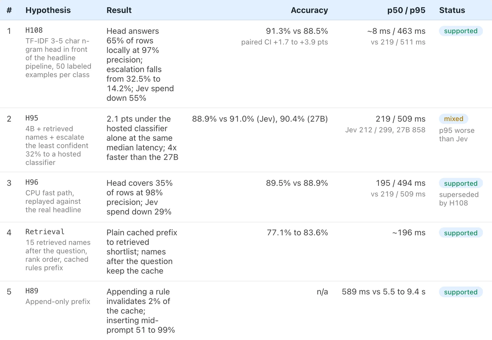
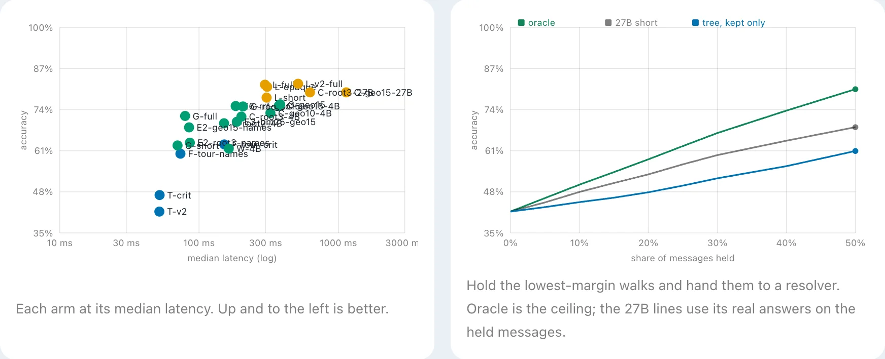
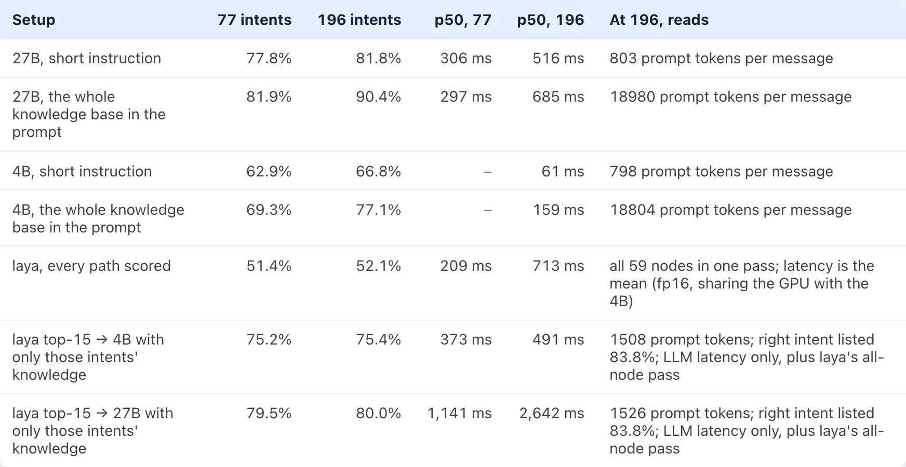

<!-- owner:scene Why did you start building Brev, or what made you want a small local router in the first place? The post gives only the research question. -->

I have been building Brev, which uses a 400M encoder called laya to walk a decision tree and read only the criteria along its path. I wanted to see if putting the knowledge into the tree would let laya match a 27B model given a short instruction, without paying the 27B's latency.

By itself, the tree lost by a wide margin. What ended up working was putting a chain of cheaper steps in front of the 27B model.

I ran the tests on Banking77 (77 intents), then 196 intents, then a 478-intent set, and logged every hypothesis in a ledger, including the failed ones. The full report is [here](/research/brev-tree-benchmark/).

<!-- owner:voice The seven numbered claims became section headings. Keep the headings, or bring the numbered list back? -->

## The three-stage chain

The chain I landed on has three stages. First, a TF-IDF head handles the rows it is confident about, which was 225 of 300 in the live run at 96.9% accuracy. Qwen3-4B (Q4_K_M) takes the rest using 8 retrieved examples. The 27B model only sees the rows the 4B is least sure about, 27 of 300 (9%), where it gets a short prompt, the top 30 candidates and 16 examples.

Measured live end to end, the chain scored 93.3% on the 300 rows, while the 27B scored 93.9% across all 4,938 rows of that set. Average latency was 49 ms per query for the chain against about 10 s for a 27B call. With 300 rows the confidence intervals are wide, so I can't tell the two accuracies apart, only that they are close.

## Walking the tree is fast, just inaccurate

laya's greedy walk runs in 52 ms at p50 and gets 47.0% on Banking77. The 27B model with a short instruction gets 77.8% at 306 ms, which puts the tree 30.8 points behind (95% CI -32.8 to -28.9).

<!-- owner:question Was anything here a surprise to you, for example the shuffled-criteria 8.9%, or the TF-IDF head beating the pipeline? One honest reaction would help the voice. -->

Most of what laya knows comes from the written criteria. Using label names alone gets 36.8%, opaque ids with criteria gets 40.6%, and both together get 47.0%. If I shuffle the criteria between sibling nodes, accuracy drops to 8.9%, so laya really is reading the text even when the text is wrong.

## Flat rules beat the tree at 196 intents

At 196 intents, giving the 27B every rule in the prompt scored 90.4% at 685 ms p50. The best 27B cascade over the tree scored 81.6% at 4,118 ms p50. Walking the tree node by node got about 40% recall, compared with 98% for flat retrieval (RRF), which the report's summary puts across 196 to 605 intents. Hypothesis H46 in the ledger concluded that any value from the tree has to come from saving prompt tokens rather than routing accuracy.

## A 4B model slows down under concurrency

In the 196-intent run, the 4B model with every rule in the prompt (about 18.8k tokens) got 77.1% at 159 ms median. That ran against llama.cpp's prefix cache with 99.9% of prompt tokens cached and one request at a time, and I didn't test it with the cache off. In two timing-only runs on the same cache (no accuracy logged), median latency went to 447 ms with 4 requests in flight and 938 ms with 8. Cache hits stayed at 99.6 to 99.9%, so the slowdown came from queueing rather than cache misses.

Where you insert a new rule changes how much of that cache survives. Appending a rule invalidated 2% of the cache (first request 589 ms), keeping rules alphabetical invalidated about 51% (5.5 s), and inserting at the front invalidated 99.8% (9.4 s). Accuracy stayed the same.

## The TF-IDF head and retrieved examples did most of the work

Putting a TF-IDF character n-gram head in front of the pipeline handled about 65% of rows locally at 97% precision. At k=50 it cut hosted-classifier spend by 56%, from \$0.29 to \$0.13 per 1k. Accuracy went up too, to 91.3% versus 88.5% for my headline pipeline (paired CI +1.7 to +3.9 points), while p50 dropped from 219 ms to about 8 ms. So the headline pipeline holds up, and a cheap trained head in front helps on both accuracy and cost.

For the 4B stage, retrieved examples made the difference. On 4,948 rows and 478 intents, the TF-IDF head alone scored 89.6%. Passing only candidate names to the 4B scored 78.6%, worse than the head. Adding the 8 nearest labelled examples lifted it to 94.0% with gold labels, and to 91.6% with simulated 27B-style label noise. Learning new intents from just a few examples is still the weak spot.

## What I don't trust yet

- The live chain ran on 300 rows (27 escalated), on one dataset and one seed. The Mac was busy with other work, and the 4B call includes about 10 to 15 ms of network overhead.
- The 27B baseline used a different prompt with all 200 classes constrained to the top 200, while the escalation stage uses a shorter prompt.
- The example labels in the 4B stage used simulated 27B-style noise instead of live 27B outputs.
- Banking77 is public, so the models could have seen it during training. The opaque-id control scored 81.2% against 81.9% with real names, so label names don't explain the 27B's lead. The 478-intent set also includes public CLINC150 labels.
- The 27B runs on a shared endpoint whose latency includes queueing, while the 4B and laya ran on a single RTX 4060.
- The 27B's latency shifts across runs: 685 ms p50 in the headline 196-intent run versus 857 ms in an earlier separate run (H93).
- The learn-as-you-go result relies on a simulated teacher, so I treat it as encouraging rather than proof.
- I curated the "top results" table by hand, so check the ledger as the source of truth.

You can [open the report](/research/brev-tree-benchmark/) to inspect the full ledger, and let me know if anything looks off.
