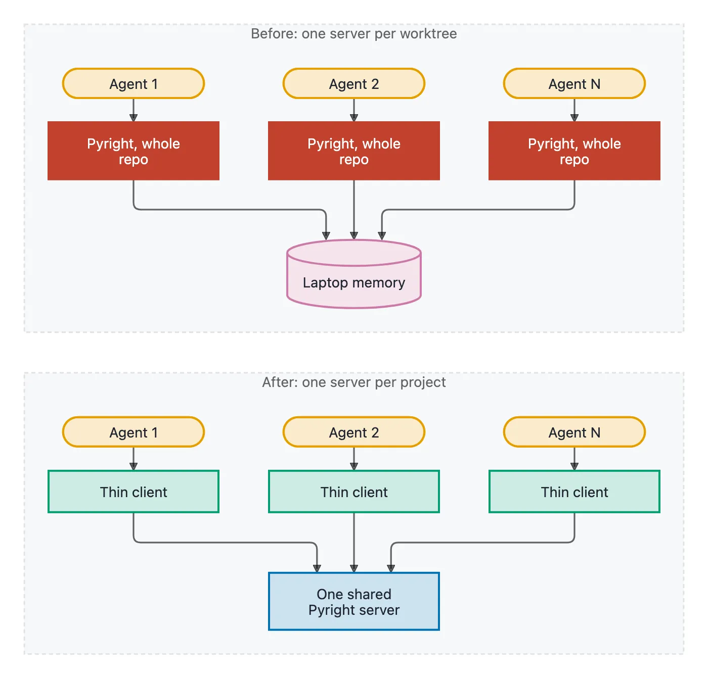
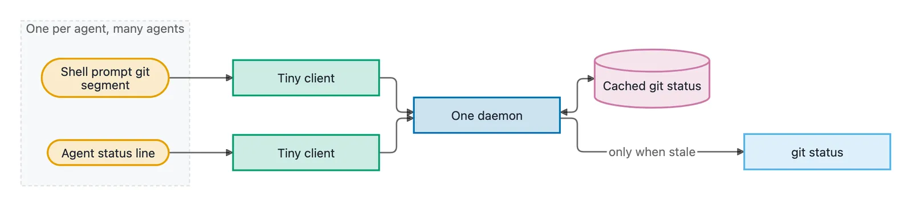
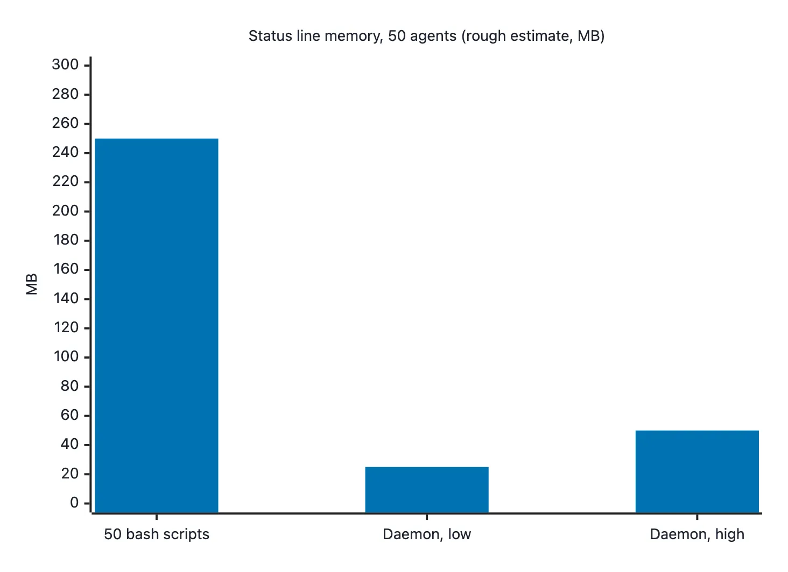

<!-- owner:voice This was dictated, so I cut the filler and split it into sections. Does it still sound like you, and is any line off? -->

I have used AI coding agents a lot for the last year and a half, maybe two. And not for simple things. At times I have had about fifty running in parallel, each in its own git worktree.

<!-- owner:scene When did you first notice the slowdown? One or two sentences on what you saw, only if it happened. -->

With that many agents, the agents are not the limit any more. My laptop is. I hit memory limits and CPU limits, and everything slows down. So here are a few things that eat resources when you run a lot of agents, and what I did about them. None of the numbers below are careful measurements. They are what I saw, or rough math.

## One Pyright server per worktree

This is the biggest one I have seen, mostly on Python projects. Each agent works in its own worktree, and each one starts its own Pyright language server. Each server loads the whole repository. If the repository is big, one server can take up to about 2 GB.

<!-- owner:fact Is the 2 GB per Pyright server something you measured (Activity Monitor, ps), or a rough guess? -->

One of those is fine. Ten or twenty of them is a lot of memory, and the machine starts to drag.

The fix I want is one shared Pyright server for all the worktrees of the same project, with a thin client per agent. You still need one server per project. But you stop holding a full copy of the repository in memory for every worktree.

<!-- owner:question Is the shared Pyright server something you run today, or still an idea? The post should say which. -->

## Small things that run on every prompt

Every agent also brings its own shells. Each shell has a prompt, and a lot of prompts run a git command on every new line to show the branch and whether it is dirty. Agents have status lines too, and those can run git status on every update. When I looked, I saw a lot of git status commands running.

<!-- owner:question Which shell prompt and status line do you use, for example zsh with a powerline theme and a custom Claude Code status line script? -->

One prompt is cheap. Hundreds of shells doing the same git work over and over is not.

## One daemon, many tiny clients

What I did was split these tools in two. There is a tiny client that the prompt or the status line calls, and one daemon that does the real git work and keeps the results cached. The client asks the daemon and returns. I did this for the git segment in my powerline prompt and for my custom Claude Code status line.

<!-- owner:question Is there one daemon for all agents, or one per project? And when does it refresh its cache: on a timer, on file changes, or on request? -->

The status line is where the numbers are easy to see. A bash status script takes at least 5 or 6 MB each time it runs. Times fifty agents, that is about 250 MB of RAM for nothing useful. A small client written in Rust plus one server should bring that down to about 25 MB in total, maybe 50.

<!-- owner:fact Are the 5 to 6 MB per bash script and the 25 to 50 MB total measured, or rough math? If measured, how? -->

*Rough estimate from the numbers above, not a measurement.*

## The general rule

Look for things that run in large numbers, dozens or hundreds of copies, and are not optimised. Each one is a small problem. Fixing it can free memory for the work you actually want done. The more agents you run, the more this matters.

The same idea works for tmux status lines, prompt plugins, or any tool that every agent starts its own copy of.

## Will I share the tools?

Maybe later. I first need to check what I can publish. They are small tools, so with a coding agent you can probably build your own.
