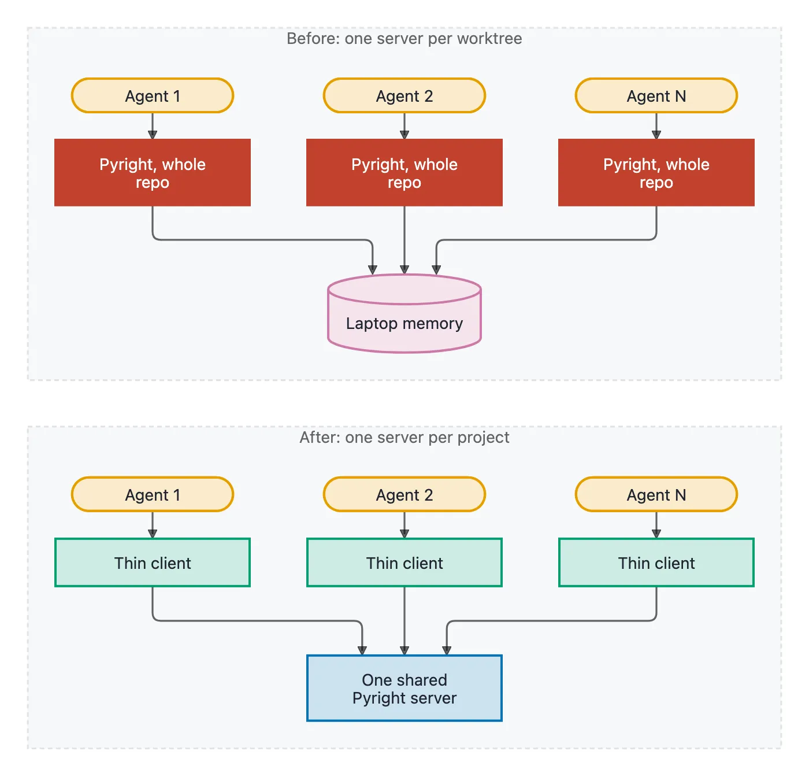
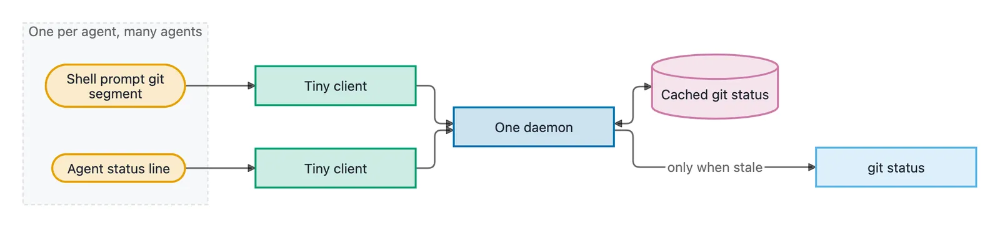
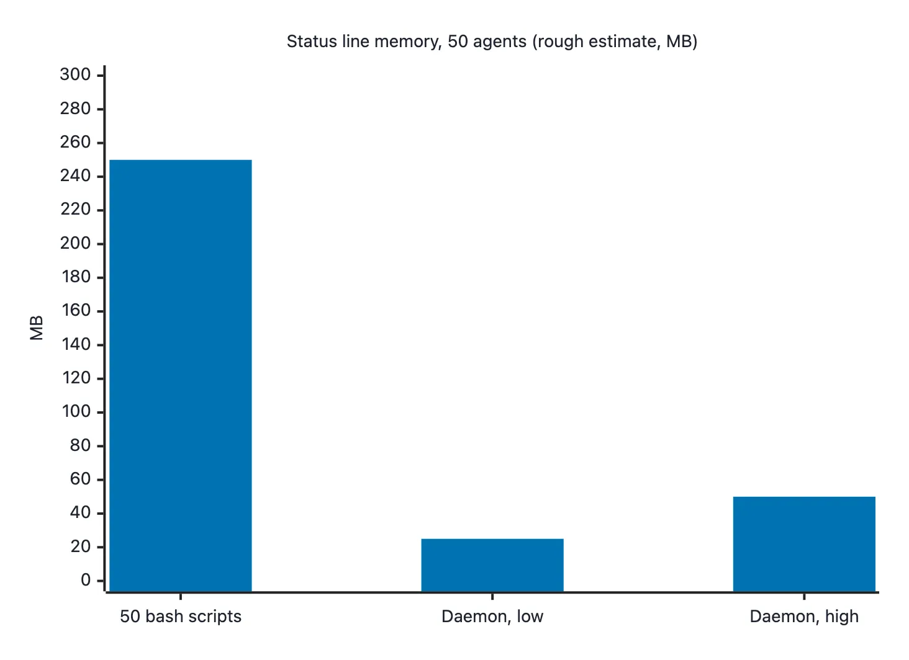

<!-- owner:voice This was dictated, so I cut the filler and split it into sections. Does it still sound like you, and is any line off? -->

I've been using AI coding agents heavily for the last year and a half, maybe two, and for fairly involved work. At times I've had around fifty running in parallel, each in its own git worktree.

<!-- owner:scene When did you first notice the slowdown? One or two sentences on what you saw, only if it happened. -->

Once you run that many agents, the bottleneck moves to your laptop. I kept hitting memory and CPU limits until everything slowed to a crawl. Below are the biggest resource hogs I ran into and what I did about them. None of these numbers are formal benchmarks; they are rough math or what I observed directly.

## One Pyright server per worktree

The biggest culprit I hit was on Python projects. Each agent works in its own worktree and starts its own Pyright language server, and every server loads the whole repository. On a large repo, a single server can take up to about 2 GB.

<!-- owner:fact Is the 2 GB per Pyright server something you measured (Activity Monitor, ps), or a rough guess? -->

Running one Pyright server is fine, but ten or twenty of them eat through RAM fast and the machine starts dragging.

What I want instead is one shared Pyright server across all worktrees of a project, with a thin client per agent. You still run one server per project, while avoiding a full copy of the repository in memory for every single worktree.

<!-- owner:question Is the shared Pyright server something you run today, or still an idea? The post should say which. -->

## Small things running on every prompt

Each agent also spawns its own shells. Most shell prompts run a git command on every new line to show the branch and dirty state, and agent status lines often run git status on every refresh too. When I checked what was running on my machine, git status was firing constantly.

<!-- owner:question Which shell prompt and status line do you use, for example zsh with a powerline theme and a custom Claude Code status line script? -->

A single shell prompt barely registers, while hundreds of shells repeating the same git work adds up quickly.

## One daemon, many tiny clients

My fix was to split these helpers in two: a tiny client called by the prompt or status line, and one daemon that actually runs git and caches the results. The client just queries the daemon and exits. I did this for the git segment in my powerline prompt and for my custom Claude Code status line.

<!-- owner:question Is there one daemon for all agents, or one per project? And when does it refresh its cache: on a timer, on file changes, or on request? -->

The memory savings are easiest to see on the status line. A bash status script uses at least 5 or 6 MB each time it runs, so across fifty agents that's roughly 250 MB of RAM spent on status text. A small Rust client talking to one server should bring the total down to around 25 MB, maybe 50.

<!-- owner:fact Are the 5 to 6 MB per bash script and the 25 to 50 MB total measured, or rough math? If measured, how? -->

*Rough estimate from the numbers above, not a measurement.*

The same pattern applies to tmux status lines, prompt plugins, or anything else that every agent starts its own copy of. Look for small unoptimized helpers running dozens or hundreds of times; cleaning those up frees memory for the work you actually care about, and the payoff grows with the number of agents you run.

I might open-source these tools later once I check what I can publish. They are small enough that you can probably build your own with a coding agent in the meantime.
