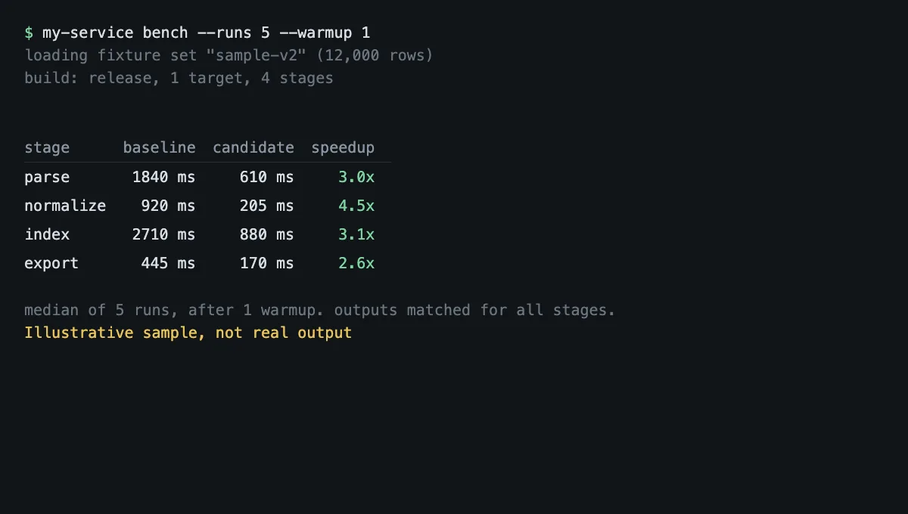
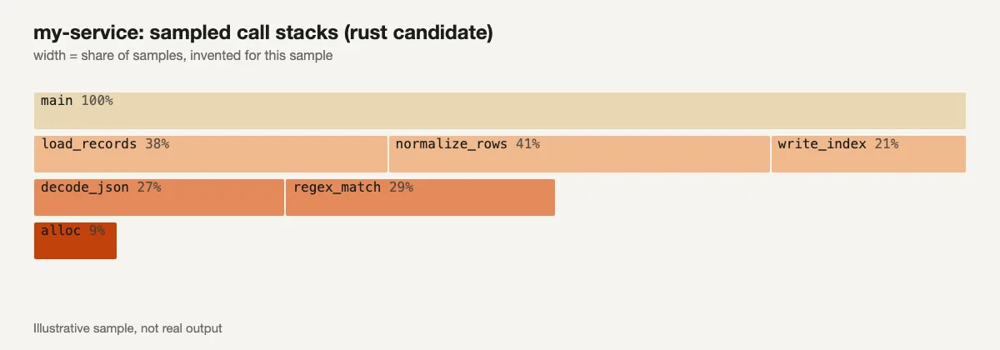

Python was the primary choice for a lot of tools I created when I first started using claude code. But as the code base became larger, it became slower and slower, and it was easy to break something when there's a change in another. There were periods of frustration feeling like the codebase is a complete bust of AI Slop.

<!-- owner:manual -->

At the same time, claude code was doing a very good job of generating code. It needed a way to prevent regressions. Initially, I tried to fix with LSP,  mypy and various tools to ensure correctness but they just felt like a bunch of hacks. This reminded me of Rust - how it has so many checks and safety features during compilation to the extent that compilation is so slow to put me off. But with agentic coding, this was a different game. I was starting to have a system where I could just prompt the instructions and the agent will do their work until completion. This was a good time to try rewriting some Python programs in Rust and here are the learnings from it.

## What I did not measure

I didn't run before-and-after benchmarks for most of this work. For the full rewrites I have no Python-versus-Rust timings at all, so I'm not claiming any speedup there. The numbers below come from commit messages, a couple of benchmark files and specific performance fixes, and I've noted where each one came from.



*Illustrative sample, not real output. The names and numbers are invented to show the layout of a before-and-after report.*

## Startup was the clearest win

One small Python helper got spawned on every call inside a long-running process. Just importing its dependencies took 7.5 seconds, and when 30 to 40 of them started at once the machine went past 150 percent CPU. Replacing it with a self-contained Rust binary dropped startup to about 12 ms according to my commit message.

That's still an observation rather than a controlled benchmark, and it bundles the language together with the import tree. A lazy-import Python rewrite would tell you how much came from the language itself. For a long-running server, I still have no Python-versus-Rust timing.

## The FFI boundary took a lot back

For numeric loops I used PyO3 and kept the Python implementation as a fallback. A day-by-day loop did well, running 6.9 times faster on a 2,000-day input (8 ms against 55 ms including marshalling). A metrics function scaled much worse: 5.1 times faster on 200 items, dropping to 2.3 times on 1,000 items because copying each column across the boundary grew with the input size.

<!-- owner:scene Was there a moment you found the date regression across the boundary? A sentence of what you saw, only if it happened. -->

Dates were the worst case. At first I passed them across as ISO strings, and formatting and parsing those strings dominated the boundary cost so badly that the faster Rust core became a 7 times regression. Switching to integer day ordinals was about 35 times cheaper to marshal and also let me drop a dependency.



*Illustrative sample, not real output. The call stacks and percentages are invented.*

It taught me to measure the boundary cost before getting excited about the compute speedup.

## The biggest speedups came from algorithms

My largest documented speedup was a git history scan. A cold call fell from 2,195 ms to 832 ms, and a memo hit still takes 308 ms under real load (mostly listing refs). That came from filtering before parsing and caching per ref snapshot, which would have worked in any language. Similarly, a lookup behind a status endpoint was doing around 1,000 connection checkouts per call; replacing that with a single query brought 512 pairs down to 28 ms on the production database.

A per-step loop went the opposite direction at first. My initial Rust version was actually slower than the code it replaced, and my commit message notes that fixing the per-step work dropped a run from 132 ms to 11 ms. Moving to Rust didn't make slow code fast automatically.

Switching one Rust service to mimalloc cut peak memory by 23 percent on a rerun with identical output, though that's Rust against Rust and says nothing about Python.

## How the bug classes moved

I wanted to see whether porting to Rust eliminated entire classes of bugs or just shifted them around. For each class I looked at when it last showed up in Python, whether it came back after the port, and what actually changed the failure mode (using relative timeline positions rather than exact dates).

Starting with rough commit-subject counts from one repository: about 50 Python-only fix commits mentioned a runtime error (`AttributeError`, `TypeError`, `NoneType`, `KeyError`). About one Rust-only fix commit did, while around 20 mentioned `panic` or `unwrap`. Event-loop or blocking words matched about 260 Python-only fix subjects and about 65 Rust-only ones. These are just subject-line matches with different word lists per language, so don't treat them as defect rates. In one Rust codebase, about 7,000 lines contain `unwrap`, about 2,700 contain `expect`, and about 500 contain `panic!`, including tests.

| Class | Last Python-era case | After the port | Mechanism now | Went away? |
|---|---|---|---|---|
| Attribute, type and None errors | Late on, a row type lacked a method. Tests mocked a dict that had it, so the bug reached production. | Panics and unwraps. A background-task panic printed one stderr line and never reached the logs. | Missing methods are compile errors; absent values go through Option and Result. A panic is still runtime. | Changed form. |
| Leaks: file descriptors and slots | Early on, a connection pool handed back open connections. | A slot leaked when a panic skipped a manual decrement. | A guard whose drop runs on every exit path, including unwinding. | Gone for guarded resources. Logic leaks still happen. |
| Memory growth from data design | A CI run hit its container limit after one test accumulated millions of mock records. | A request loaded stored payloads for every row, twelve at a time, and the pod ran out of memory. | Not the language. The design loaded too much. | Did not change. |
| Hangs on a dependency | Timeouts were added to the cache clients. Later, a sync timeout did not abort the call. | A cache client with no default timeouts hung every call when the server stopped answering. | Explicit timeouts in one shared place. | Did not change. Same fix. |
| Deadlocks and blocking | About 260 Python-only fix subjects touched event-loop or blocking work. | A logging layer re-entered its own writer lock. A writer lock was held across slow work. | Thread locks, not the event loop. A plain mutex deadlocks when its own thread takes it again. | Changed form. |
| Log floods | Flood fixes in the Python period. | Three always-on logs, one writing tens of thousands of lines a day. | The same. | Did not change. |

My read is that explicit types and error returns drove most of the drop in runtime-error fixes, though I can't separate that cleanly from the churn of the rewrite itself. None of these bug classes vanished completely. I did see fewer CI memory failures in Rust-only commits than in Python-era ones, though the counts are too noisy to conclude they are gone.

## A calculation engine that missed its targets

One calculation engine built on a Rust formula library missed most of its performance targets. On a 100,000-row sheet, a full recompute took about 15.6 seconds against a 1.5 second target, and a single edit took about 1.6 seconds against a 30 ms target. Only loading a snapshot (19 ms) came in well under target.

Because the pinned library has no partial-evaluation API, every single edit forces a full pass over 400,000 formula cells. On top of that, the regression gate only alerts on a 20 percent slowdown versus the last baseline instead of checking the actual target. I haven't fixed this yet.

## Bugs that had nothing to do with the borrow checker

The borrow checker slowed me down a bit, though the bugs that actually hurt were three other things.

<!-- owner:scene How did you find the silent server (workers parked on the database mutex)? A sentence of what you saw, only if it happened. -->

First, async worker threads were taking a blocking database mutex, so under load the server went quiet with most workers parked on the same lock. I put in a bounded lock and a watchdog thread as a stopgap; the real fix, a writer actor, is still pending. Second, a cache cleanup step on a shared CI runner deleted the cargo home while other jobs were using it, breaking unrelated builds until I made that cache opt-in on shared runners. Third, `cargo test` runs tests inside one shared process, so a test mutating an environment variable broke its neighbours until I switched to injecting paths instead. The float drift and bare-except bugs I hit are down in the pitfalls section.

## What changed with coding agents

With coding agents, Rust paid off mainly for the checks an agent can't reliably run on its own, while the case for fewer overall bugs was much less clear.

This isn't a clean comparison of hand-written Python against agent-written Rust, since I couldn't measure agent share cleanly in either period. In one repository, about 1 in 8 Python-only commits carries an explicit co-author trailer naming an AI model, compared with about 1 in 100 Rust-only commits. Using a broader signal like a trailer or a task id breaks down because human commits carry task ids too. Since those two markers disagree, I can't claim both eras had the same mix of agent code, and the Rust history is shorter and mixed with other work anyway.

What the Rust compiler gave agents was a specific error inside their own loop instead of a production failure later. In a two-caller toy Rust crate, changing a function signature immediately produced one compile error per caller. Here is how different failure modes showed up across both languages:

| Bug | Python | Rust |
|---|---|---|
| Method or field missing on a type | Runtime, in production, when tests mocked it away | Compile error. The code does not build. |
| Enum variant added, match not updated | Runtime, or a silent default | Compile error for a non-exhaustive match. One commit made a case compile-time exhaustive across two files. |
| Two branches change one signature and merge close together | Runtime, on the paths the tests reached | Compile break on main after the merge, fixed by two more commits. The gate ran after the merge, not before. |
| Call dropped during a merge | Silent | Silent. A merge removed the audit calls, and nothing failed to compile because the calls were simply absent. |
| Lint drift | Ruff and mypy red on main. One change waited until the mypy errors were fixed. | Clippy with warnings as errors red across every open pull request for a while, about forty lints. |
| Borrow error | Not applicable | A lifetime error in a test was caught by the compiler and "fixed" with unwrap. |

Some things got worse with Rust. In CI on one repository, the verify job jumped from a median of 1.9 minutes to 16.3 minutes, and the test job went from 8.2 to 39.2 minutes across 200 successful runs per side, although the runner labels changed around the same time so I can't separate language from hardware. Agents also reach for `unwrap` and `clone` freely (I only counted the `unwrap` lines, not `clone`). I also saw new modules that were never wired into the entry point, a merge that silently dropped whole call paths, and concurrent pull requests that merged cleanly in git and still broke the build.

For scripts, glue, ML code and tests running against real objects, Python agent loops worked well and ran fast enough to iterate quickly. Python still brought real runtime errors and documented asyncio blocking, though in my experience the loop held up whenever tests used real objects, and the mock outage was a test-design mistake.

I also checked the most recent 300 CI runs in one repository: about three in four had at least one failing job. Lint and spec failed in about 73 percent of runs, web UI and security audit in about 64 percent, Rust tests in about 61 percent, and end-to-end tests in about 22 percent. Because the lint job also runs `cargo build` alongside advisory Python checkers, I can't split compile failures from test failures. I also have no count of how many agent loops ended in compiler errors since the repo doesn't log per-iteration runs.

Two public papers line up with that narrow point. FeedbackEval (arXiv 2504.06939) tested code repair across five language models and found 49.2 percent success with compiler feedback alone, 57.9 percent with test feedback, and 63.6 percent with both combined (though it isn't a Rust study or a Python comparison). A 2026 preprint (arXiv 2607.13921) feeds compiler diagnostics during generation on repository-level Rust tasks, though its abstract gives no numbers I could check. Taken together, feedback type matters and compiler errors alone aren't enough for the loop.

The compiler never caught the design-level memory growth, the dependency hang or the dropped audit calls. I would still choose Rust for a long-running service with tight resource constraints, just not under the assumption that agents can ship it unsupervised. What would change my mind is a whole-service comparison with the same agent setup in both languages, timed to a correct green change.

## What stayed in Python

I kept ML training, pandas workflows, the React and TypeScript front ends, shell glue, and the GPU model workers (which a Rust process launches) where they were, and I don't plan to rewrite them.

## Practical guide

### When it makes sense

Short-lived processes that get spawned repeatedly are the easiest yes. For long-running services I have no whole-service timing comparison, so my case for Rust there is purely my judgment on reliability and simpler packaging. Numeric loops are only worth porting if the whole loop stays inside Rust. If a service mostly waits on the network or a database, don't expect much speed gain; the value is fewer error paths and shipping a single binary instead of wrestling with virtualenvs and interpreter drift. Whatever you port, budget time for a parity audit: one of mine turned up well over a hundred differences between the Python reference and the Rust port.

### Migration path that worked

1. Benchmark the old code on real inputs and record the machine: cold start of the actual entry point, per-call time at real input sizes with marshalling included, and memory after a long run instead of just a single-run peak.
2. Count how often data crosses the language boundary on each call.
3. Port leaf functions first behind the existing Python signature, keeping the Python version as a fallback.
4. Write tests first, including degenerate inputs, then run both versions on the same inputs with one parity test per helper and count every output difference.
5. Verify that every rewritten module is actually called from the real entry point (some of mine sat unreachable for a while), and inspect merges for calls that disappeared.
6. Keep the Python reference around until the parity audit passes, then delete it in one commit.

When agents are writing the code, put `cargo check`, clippy with warnings as errors and `cargo deny` inside the agent loop and in the pre-merge gate (checking after merge catches breaks too late). Add a lint against `unwrap` and `expect` in non-test code so exceptions have to be explicit, keep pull requests small, and check diffs for deleted lines too.

### Pitfalls and fixes

Send dates across the FFI boundary as `toordinal()` integers instead of strings:

```python
# slow: strings cross the boundary and get parsed on both sides
days = [d.isoformat() for d in dates]
# cheaper: one integer per day
days = [d.toordinal() for d in dates]
```

Put a deadline on blocking locks touched from async threads, and move blocking work onto the blocking pool:

```rust
// parking_lot mutex: give up instead of parking an async worker forever
let Some(guard) = db.try_lock_for(Duration::from_secs(2)) else {
    return Err(Overloaded);
};
// blocking file or database work goes to the blocking pool
let rows = tokio::task::spawn_blocking(move || load_rows(path)).await?;
```

Always log the exception before falling back to the reference path. A bare `except` in my code quietly hid a fallback failure until I added a warning log:

```python
try:
    value = fast_path(data)
except Exception:
    logger.warning("fast path failed, using the reference", exc_info=True)
    value = reference(data)
```

Three smaller things to watch for:

- Float drift: some Rust and SciPy sums differed by 1 to 3 ULPs, so my parity tolerances sat between 1e-9 and 1e-6.
- Silent defaults: one Rust helper returned 0.5 for AUC on degenerate input where the reference returned `nan`, and another ignored labels other than 0 and 1. The type system caught neither, so put degenerate cases in tests.
- Panic policy: decide it up front. `unwrap` calls in request handlers were a real hazard in my code, and I had to convert them to error returns by hand in one commit; enforce it with a lint if you want it to stick.

### Tooling that paid off

- Pin one exact toolchain version in the toolchain file and in CI. Mine used "stable" locally and an older pinned release in CI, so local and CI builds disagreed.
- Run `cargo fmt --check`, `cargo clippy -D warnings`, `cargo deny` (advisories and licences) and `cargo machete` (unused dependencies) in one CI gate.
- Use `clippy.toml` `disallowed-methods` to block risky APIs. I banned spawning tasks outside a single module so shutdown drains cleanly, and banned cache connections without timeouts.
- Build with `--locked` and reject pull requests where the lockfile drifts from the manifest.

I still don't have a clean Python-versus-Rust measurement for a whole service, so that's the next thing I want to test using the same agents on both sides.
