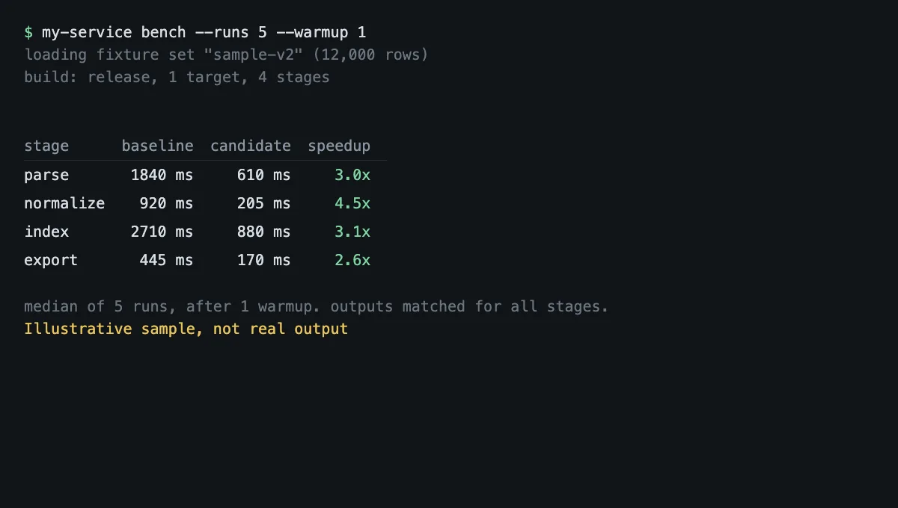
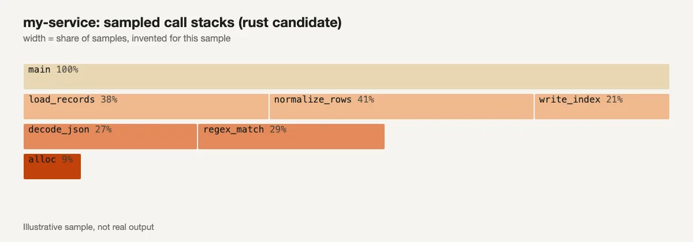

This year I rewrote several of my Python programs in Rust, some small and some not. I'll keep their names out of it. AI coding agents did a lot of the work, so I also wanted to know if that changed the answer.

Short version: the clearest speed win was startup, and most other gains came from algorithm changes, not the language. The FFI boundary can take back most of a numeric gain. Some bugs moved to compile time, but hangs and design-level memory growth did not move at all. There is a checklist at the end if you are weighing the same move.

## What I did not measure

Most of this work has no before-and-after benchmark. For the full rewrites I have no Python-versus-Rust timing at all, so I claim no speedup for them. The numbers below come from commit messages, a couple of benchmark files and performance fixes, and each says where it came from.



*Illustrative sample, not real output. The names and numbers are invented to show the layout of a before-and-after report.*

## Startup was the clearest win

A small Python helper ran on every call inside a long-running process. Its import took 7.5 seconds, and with 30 to 40 of them starting at once the machine went past 150 percent CPU. I replaced it with a self-contained Rust binary. My commit message says it starts in about 12 ms.

That is not a benchmark, and it mixes the language with the import tree. A lazy-import Python version would show how much of the gap is the language. For a long-running server I have no Python-versus-Rust timing.

## The FFI boundary took a lot back

For the numeric parts I used PyO3 and kept the Python code as a fallback. A day-by-day loop looked great: 6.9 times faster per run on a 2,000-day input, 8 ms against 55 ms with marshalling included. A metrics function did not hold up. It was 5.1 times faster on 200 items but only 2.3 times on 1,000, because the cost of passing each column across grows with the input.

Dates were the worst. I sent them as ISO strings at first, and formatting the strings dominated the boundary cost, turning the faster core into a 7 times regression. Integer day ordinals were about 35 times cheaper to marshal, and they removed a dependency.



*Illustrative sample, not real output. The call stacks and percentages are invented.*

So count the boundary before you count the compute.

## The biggest wins were not the language

My largest documented speedup is a git history scan. A cold call dropped from 2,195 ms to 832 ms, and a memo hit still takes 308 ms under real load, mostly listing refs. It came from filtering before parsing and caching per ref snapshot, which any language would need. A lookup behind a status call made about 1,000 connection checkouts per call. One query replaced them and measured 28 ms for 512 pairs on the production database. Again, an algorithm change.

A per-step loop went the other way. The first Rust version was slower than the code it replaced, and my commit message says fixing its per-step work took a run from 132 ms to 11 ms. Rust was not fast on its own.

Switching a service to mimalloc cut its peak memory by 23 percent on a rerun with identical output. That is Rust against Rust, so it says nothing about Python.

## How the bug classes moved

I wanted to know if the rewrite removed a class of bug or only moved it. For each class I checked when it last showed up in Python, whether it came back after the port, and what changed the mechanism. Positions are relative, not dates.

Some rough counts from one repository first. About 50 Python-only fix commits had a runtime-error word in the subject (AttributeError, TypeError, NoneType, KeyError). About one Rust-only fix commit did, and about 20 had panic or unwrap. Event-loop or blocking words matched about 260 Python-only fix subjects and about 65 Rust-only ones. These are subject-line counts with different word lists per language, not defect rates. In one Rust codebase, about 7,000 lines contain unwrap, about 2,700 expect and about 500 panic!, test code included.

| Class | Last Python-era case | After the port | Mechanism now | Went away? |
|---|---|---|---|---|
| Attribute, type and None errors | Late on, a row type lacked a method. Tests mocked a dict that had it, so the bug reached production. | Panics and unwraps. A background-task panic printed one stderr line and never reached the logs. | Missing methods are compile errors; absent values go through Option and Result. A panic is still runtime. | Changed form. |
| Leaks: file descriptors and slots | Early on, a connection pool handed back open connections. | A slot leaked when a panic skipped a manual decrement. | A guard whose drop runs on every exit path, including unwinding. | Gone for guarded resources. Logic leaks still happen. |
| Memory growth from data design | A CI run hit its container limit after one test accumulated millions of mock records. | A request loaded stored payloads for every row, twelve at a time, and the pod ran out of memory. | Not the language. The design loaded too much. | Did not change. |
| Hangs on a dependency | Timeouts were added to the cache clients. Later, a sync timeout did not abort the call. | A cache client with no default timeouts hung every call when the server stopped answering. | Explicit timeouts in one shared place. | Did not change. Same fix. |
| Deadlocks and blocking | About 260 Python-only fix subjects touched event-loop or blocking work. | A logging layer re-entered its own writer lock. A writer lock was held across slow work. | Thread locks, not the event loop. A plain mutex deadlocks when its own thread takes it again. | Changed form. |
| Log floods | Flood fixes in the Python period. | Three always-on logs, one writing tens of thousands of lines a day. | The same. | Did not change. |

My judgment is that most of the drop in runtime-error fixes came from explicit types and error returns, but I cannot separate that from the rewrite's own churn.

So no class went away everywhere. I found CI memory failures in Python-era commits and fewer in Rust-only ones, but the count is too rough to say they went away.

## A miss

A calculation engine I built on a formula library missed most of its targets. On a 100,000-row sheet a full recompute took about 15.6 seconds against a 1.5 second target, and a single edit about 1.6 seconds against 30 ms. Only loading a snapshot, at 19 ms, was well inside its target.

The pinned library has no partial-evaluation API, so every edit is a full pass over 400,000 formula cells. And the regression gate only checks for a 20 percent slowdown against the last baseline, not against the target. I have not fixed it.

## Bugs that were not the borrow checker

The borrow checker cost me some time, but not the kind that mattered. Three other bugs did.

A blocking database mutex was taken on async worker threads, and under load the server went silent with most workers parked on the same lock. The fix was a bounded lock and a watchdog thread. The proper fix, a writer actor, is still pending. A cache cleanup step on a shared CI runner pruned the cargo home other jobs were using, so unrelated builds failed, and I made the cache opt-in on shared runners. And `cargo test` runs every test in one process, so a test that changes an environment variable breaks its neighbours. The fix was to inject paths instead.

The float drift and the bare except are in the pitfalls below.

## Did agentic coding change the answer?

Partly. Rust was worth it for the checks an agent cannot run itself. It was not clearly worth it for fewer bugs overall.

This is not hand-written Python against agent-written Rust, because I could not measure agent use cleanly in either era. In one repository, about 1 in 8 Python-only commits has an explicit co-author trailer naming an AI model, against about 1 in 100 Rust-only commits. A broader marker, a trailer or a task id, does not measure AI use, since the repo also puts task ids on human commits. The two markers disagree, so I cannot say the eras had matched agent shares. The Rust history is also shorter and mixed with other work.

What the compiler gave an agent was a precise error inside its own loop instead of an incident later. In a two-caller toy Rust crate, changing one function signature gave one compile error per caller. Here is where each kind of bug surfaced:

| Bug | Python | Rust |
|---|---|---|
| Method or field missing on a type | Runtime, in production, when tests mocked it away | Compile error. The code does not build. |
| Enum variant added, match not updated | Runtime, or a silent default | Compile error for a non-exhaustive match. One commit made a case compile-time exhaustive across two files. |
| Two branches change one signature and merge close together | Runtime, on the paths the tests reached | Compile break on main after the merge, fixed by two more commits. The gate ran after the merge, not before. |
| Call dropped during a merge | Silent | Silent. A merge removed the audit calls, and nothing failed to compile because the calls were simply absent. |
| Lint drift | Ruff and mypy red on main. One change waited until the mypy errors were fixed. | Clippy with warnings as errors red across every open pull request for a while, about forty lints. |
| Borrow error | Not applicable | A lifetime error in a test was caught by the compiler and "fixed" with unwrap. |

Some things got worse. In CI on one repo the verify job went from a median of 1.9 minutes to 16.3, and the test job from 8.2 to 39.2 (200 successful runs per side), but the runner labels changed along with the language, so I cannot separate the two. Agents reach for unwrap and clone; the unwrap line count is my only evidence, and I did not count clones. Some new modules were never reached from the entry point, a merge dropped whole call paths, and concurrent pull requests merged cleanly in git and still broke the build.

Python agent loops were fine for scripts, glue, ML code and tests against real objects, and a Python test run is fast enough to loop on many times. Python had its own trouble: real runtime errors and documented asyncio blocking. My read is that the Python loop worked when tests ran real objects, and the mock case was a test design failure, not a Python one.

I also tallied CI failures. Of the most recent 300 CI runs in one repository, about three in four had at least one failing job. Lint and spec failed in about 73 percent of those runs, web UI and security audit in about 64, Rust tests in about 61 and end-to-end in about 22. The lint job also runs a cargo build and advisory Python checkers, so I cannot split compile errors from test failures. I did not measure how many agent iterations ended in compiler errors; the repo keeps no per-iteration log.

Two public papers are relevant. FeedbackEval (arXiv 2504.06939) found that on code repair tasks, across five language models, compiler feedback alone gave 49.2 percent success, test feedback 57.9 percent and both together 63.6 percent. It is not a Rust study and not a Python comparison. A 2026 preprint (arXiv 2607.13921) gives compiler feedback during generation on repository-level Rust tasks, but its abstract gives no figures I could check. Together they support one narrow point: feedback type matters, and compiler feedback alone is not the whole loop.

The compiler did not catch the design memory problem, the hang or the dropped audit calls. I would still pick Rust for a long-running service with strict resource rules, but not because an agent can write it unsupervised. What would change my mind is a whole-service comparison with the same agent setup in both languages, measured as time to a correct, green change.

## What stayed in Python

ML training, pandas workflows, the React and TypeScript front ends, shell glue, and the GPU model workers, which a Rust process starts. I did not rewrite those and I do not plan to.

## A practical guide

### Decision checklist

- **Short-lived process that starts many times:** strong case.
- **Long-running service:** no whole-service timing from me. The case rests on reliability and packaging, and those are my judgments.
- **Numeric loop:** only if the loop stays inside Rust.
- **Mostly waiting on the network or a database:** expect little speed gain. The gain is fewer error paths and simpler packaging.
- **Packaging pain** (virtualenvs, interpreter drift): a single binary removed a real chore for me.
- **Budget for a parity audit.** One of mine found well over a hundred gaps between the Python reference and the Rust code.

### Migration path that worked

1. Benchmark the old version on the same input and note the machine: cold start of the real entry point, time per call at the real input size with marshalling, and memory after a long run, not only the peak of one run.
2. Count how many times data crosses the boundary per call.
3. Rewrite leaf functions first, behind the same Python signature, with the Python version kept as a fallback.
4. Write tests first, including the degenerate inputs. Run both versions on the same inputs, one parity test per helper, and count the output differences.
5. Check that every rewritten module is reachable from the real entry point (some of mine were not, for a while), and read merges for calls that went missing.
6. Keep the Python reference until the audit passes, then delete it in one commit.

If agents write the code, run `cargo check`, clippy with warnings as errors and `cargo deny` in the agent loop and again in the gate that blocks a merge; a gate after the merge catches the break too late. Lint against `unwrap` and `expect` in non-test code, with each exception explicit. Keep pull requests small, and read diffs for removed lines, not only added ones.

### Pitfalls and fixes

- **Dates across the boundary:** send `toordinal()` integers, not strings.

```python
# slow: strings cross the boundary and get parsed on both sides
days = [d.isoformat() for d in dates]
# cheaper: one integer per day
days = [d.toordinal() for d in dates]
```

- **Blocking locks on async threads:** give the lock a deadline, and move blocking work off the async threads.

```rust
// parking_lot mutex: give up instead of parking an async worker forever
let Some(guard) = db.try_lock_for(Duration::from_secs(2)) else {
    return Err(Overloaded);
};
// blocking file or database work goes to the blocking pool
let rows = tokio::task::spawn_blocking(move || load_rows(path)).await?;
```

- **Fallbacks that hide failures:** log the exception before you fall back. My bare except hid a fallback failure until I added a logged warning.

```python
try:
    value = fast_path(data)
except Exception:
    logger.warning("fast path failed, using the reference", exc_info=True)
    value = reference(data)
```

- **Float drift:** some Rust and SciPy sums differed by 1 to 3 ULPs. My tolerances ranged from 1e-9 to 1e-6.
- **Silent defaults:** one Rust helper returned 0.5 for AUC on degenerate input, where the reference returns nan. Another ignored labels other than 0 and 1. The type system caught neither, so write the degenerate cases as tests.
- **Panic policy:** decide it before you start. Unwrap calls in request handlers were a real risk in my code, and one commit converted them to error returns by hand. Make the rule a lint if you want it enforced.

### Tooling that paid off

- One exact toolchain in the toolchain file and in CI. Mine said "stable" locally and pinned an older release in CI, so builds could disagree.
- `cargo fmt --check`, `cargo clippy -D warnings`, `cargo deny` (advisories and licences) and `cargo machete` (unused dependencies), in one CI gate.
- `clippy.toml` `disallowed-methods` to ban risky calls. I banned task spawning outside one module, so tasks drain on shutdown, and banned cache connections without timeouts.
- `--locked` builds, and a CI check that rejects a lockfile that no longer matches the manifest.

## Where I am

Rust made a few short processes much faster, and some numeric loops faster until the boundary ate part of the gain. The biggest real wins were algorithm changes.

The reliability gain is narrow. Some type errors moved to compile time and guarded resources stopped leaking, but hangs, timeouts and panics did not go away, and the memory problem I hit was a design problem. I still do not have a clean Python-versus-Rust number for a whole service. That is the next thing I want to measure, with the same agents on both sides.
